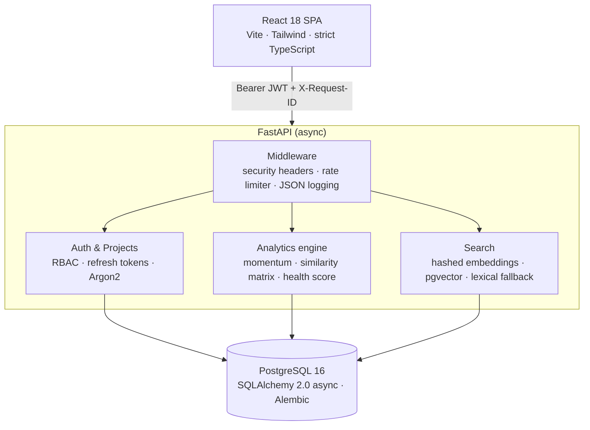

# ResearchForge

**A multi-user workspace for collecting research papers, comparing them, and spotting gaps, with a scoring engine that treats a literature collection like a portfolio.**

[](https://github.com/Arushi-1011/researchforge/actions)


<!-- [TODO] Add a 20-30s demo GIF here: guest login -> import papers -> health score -> export PDF -->
<!--  -->

---

## The problem

Literature reviews get messy fast: papers scattered across tabs and PDFs, no quick way to tell whether a reading list is *broad or redundant*, and no shared workspace for a team. ResearchForge keeps papers, notes, comparisons, and gaps in one place, and gives each collection a quantitative health check.

## What it does

| Area | Capability |
|---|---|
| **Ingestion** | Import papers via arXiv and Semantic Scholar APIs; extract selectable text from PDFs |
| **Analysis** | Metadata-linked comparison matrices, research-gap tracking |
| **Scoring** | Per-collection health score from coverage, diversity, recency, and momentum (see [Scoring model](#scoring-model)) |
| **Search** | Vector search over 384-dim hashed embeddings (pgvector), with lexical fallback |
| **Export** | Deterministic HTML / DOCX / PDF compilation (WeasyPrint) |
| **Collaboration** | Workspaces with `OWNER` / `EDITOR` / `VIEWER` roles |
| **Ops** | JWT auth with rotating refresh tokens, per-user rate limiting, structured JSON logs with request tracing |

---

## Architecture



**Stack:** FastAPI · SQLAlchemy 2.0 (asyncpg) · Alembic · PostgreSQL 16 + pgvector · React 18 · Vite · Tailwind · Vitest · Playwright · Docker Compose · Caddy · GitHub Actions

---

## Design decisions

| Decision | Why | Trade-off |
|---|---|---|
| **Refresh tokens: random + SHA-256 hashed in DB** | Tokens are 256-bit random, so a fast hash is safe and cheap per request. A DB leak doesn't expose usable tokens. | Not suitable for low-entropy secrets, which is why **passwords use Argon2** instead. |
| **Rotate refresh tokens on every use** | Limits the window of a stolen token; `/auth/logout` revokes immediately. | One extra DB write per refresh. |
| **RBAC enforced as a FastAPI dependency (`require_owner`)** | Authorization lives in one place, not scattered across handlers. Destructive routes can't be added without it being visible. | Role checks hit the DB; no caching yet. |
| **In-process sliding-window limiter** (10 req / 60 s / user) | Zero infrastructure, easy to test, protects expensive endpoints. | State is per-process. Behind multiple workers or replicas the effective limit multiplies. Redis is the fix (see [Roadmap](#known-limitations--roadmap)). |
| **Hashed embeddings instead of a learned model** | Deterministic, no model download, no network, fully unit-testable. | Captures lexical overlap, **not** true semantics. Synonyms won't match. |
| **Graceful fallback to lexical search** | App still works if pgvector isn't available. | Two code paths to keep consistent. |

---

## Scoring model

Each collection gets a 0-100 health score:

```
score = 0.25 * coverage + 0.35 * diversity + 0.25 * recency + 0.15 * momentum
```

- **Coverage**: how much usable text was extracted per paper.
- **Diversity**: 1 minus mean pairwise cosine similarity of TF-IDF vectors. Low overlap means a broader collection.
- **Recency**: exponential decay with a 5-year half-life.
- **Momentum**: rolling-window publication velocity, expressed as a z-score against its own trend.

The score maps to a label (`STRONG_BUY`, `HOLD`, `REBALANCE`). These labels are **a deliberately playful UI framing of the portfolio analogy**, not financial advice or a validated predictor. The weights are heuristic and have not been tuned against ground truth.

---

## Benchmarks

Pairwise cosine similarity matrix and momentum computation, vectorized with NumPy:

| Corpus size | Pairs | Matrix latency (mean) | Momentum latency |
|---|---|---|---|
| 10 papers | 45 | 0.28 ms | 0.01 ms |
| 50 papers | 1,225 | 1.21 ms | 0.03 ms |
| 100 papers | 4,950 | 2.59 ms | 0.08 ms |
| 250 papers | 31,125 | 7.83 ms | 0.33 ms |

<!-- [TODO] Fill in: chip/CPU, Python version, NumPy version, number of runs. -->
*Environment: `[CPU]`, Python 3.12, NumPy `[x.y]`, mean of `[N]` runs. Pure in-memory math, no network or DB.*

Reproduce: `python backend/benchmarks/benchmark_quant.py`

Scaling note: the similarity matrix is O(n²) in corpus size. That is fine for per-project collections (hundreds of papers) and would need blocking or approximate nearest neighbours well beyond that.

---

## Quickstart

### Docker Compose (full stack)

```bash
git clone https://github.com/Arushi-1011/researchforge.git
cd researchforge
cp .env.example .env            # review and set secrets
docker compose up --build -d
docker compose exec api alembic upgrade head
```

| Service | URL |
|---|---|
| Web app | http://localhost:5174 |
| API | http://localhost:8001 (OpenAPI docs at `/docs`) |
| PostgreSQL | localhost:5433 |

Click **"Guest Demo"** on the login screen for instant access without signing up.

### Local development

```bash
# Backend
cd backend
python3 -m venv .venv && source .venv/bin/activate
pip install -e '.[dev]'
pytest

# Frontend
cd ../frontend
npm ci
npm test -- --run
npm run build && npm run dev
```

`make` targets are available for common tasks; run `make help` or read the `Makefile`.

---

## Testing

| Layer | Tooling | What's covered |
|---|---|---|
| Backend | `pytest` | Quant math and embeddings as pure functions (no mocks); auth and RBAC paths |
| Frontend | Vitest + React Testing Library | 8 component tests |
| Types | `tsc --noEmit` | Strict TypeScript across routes and API bindings |
| E2E | Playwright | Core user workflow |
| CI | GitHub Actions | Runs on every push |

<!-- [TODO] Add a coverage badge/report and replace this comment with the real number. -->

---

## Project structure

```
backend/      FastAPI app, Alembic migrations, benchmarks, tests
frontend/     React + Vite SPA
e2e/          Playwright workflow specs
docs/         Additional documentation
Caddyfile     Reverse proxy config
docker-compose.yml, Makefile, .env.example
```

---

## Known limitations & roadmap

Being upfront about what this is and isn't:

- **Rate limiter is per-process.** Not safe for multi-replica deployment. *Next: Redis-backed limiter.*
- **Embeddings are hashed, not learned.** Lexical similarity only. *Next: swap in a sentence-transformer behind the same interface.*
- **Scoring weights are heuristic.** *Next: validate against a labelled set of "good" vs "redundant" reading lists.*
- **No caching layer.** Every analytics request recomputes from the DB. *Next: cache per-project results, invalidate on paper changes.*
- **Similarity matrix is O(n²).** Fine at current scale. *Next: approximate nearest neighbours for large corpora.*

---

## Security

Passwords are hashed with Argon2; refresh tokens are stored only as SHA-256 hashes; responses carry `nosniff`, frame-deny, and CSP headers. To report a vulnerability, see the repository's Security policy.

## License

<!-- [TODO] Add a LICENSE file (MIT is a common default) and name it here. -->
