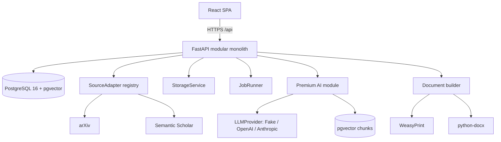
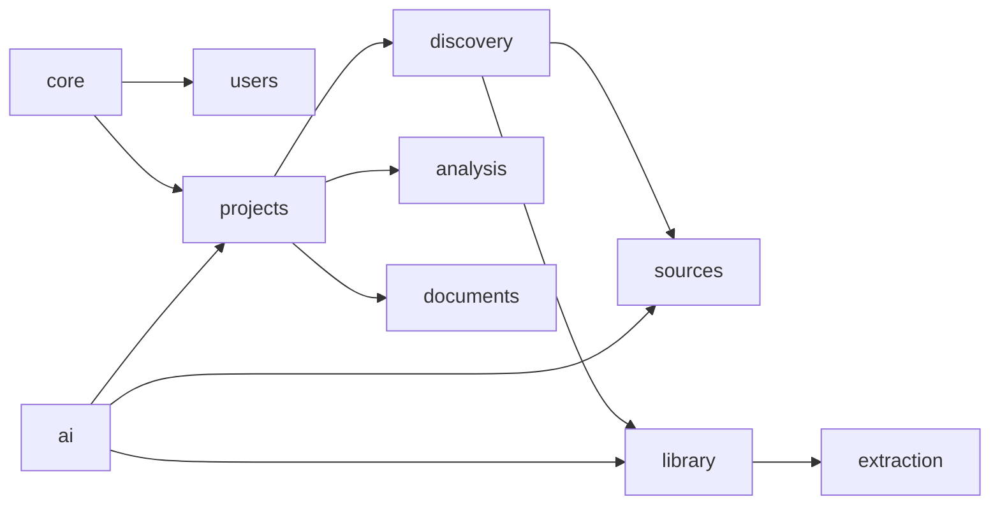
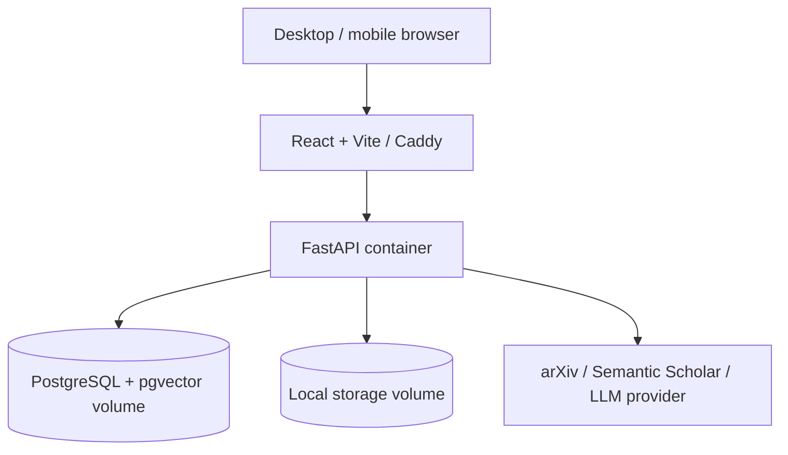
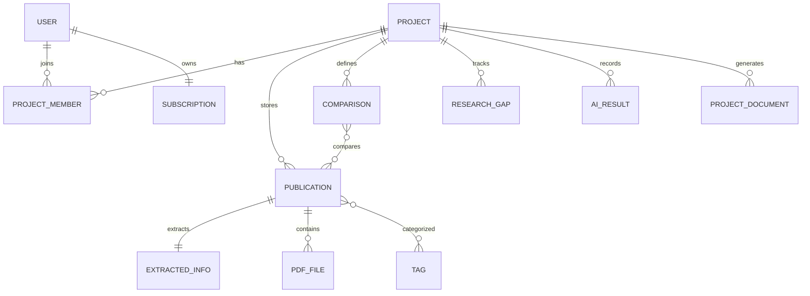

# ResearchForge architecture

## Component diagram

## Package diagram

## Deployment diagram

## ER diagram

## Module boundaries

Routers handle HTTP validation and dependencies; services contain business rules; repositories/models own persistence. Only source adapters communicate with publication APIs, only `ai/llm` calls LLM vendors, and only `storage` handles file-system operations. AI is a dependency leaf and must not be imported by extraction, discovery, library, analysis, documents, or projects.
